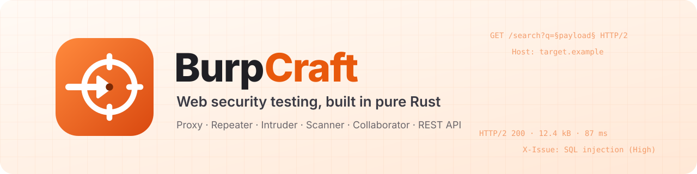
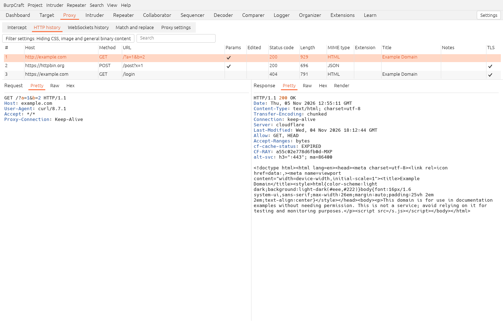
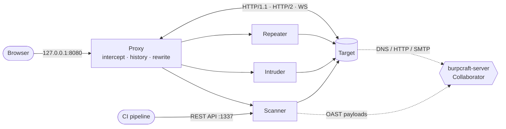

<p align="center">
  <picture>
    <source media="(prefers-color-scheme: dark)" srcset="docs/brand/banner-dark.svg">
    
  </picture>
</p>

<p align="center">
  <b>An open-source intercepting proxy, scanner and attack toolkit for web security testing, built in pure Rust.</b>
</p>

<p align="center">
  <a href="https://github.com/Bosiux/burpcraft/actions/workflows/ci.yml"></a>
  <a href="https://github.com/Bosiux/burpcraft/releases"></a>
  
  
  
  
  
</p>

<p align="center">
  <a href="#features">Features</a> ·
  <a href="#how-it-fits-together">How it fits together</a> ·
  <a href="#quick-start">Quick start</a> ·
  <a href="#self-hosting-the-collaborator-and-bapp-store">Collaborator</a> ·
  <a href="#rest-api">REST API</a> ·
  <a href="#mcp-server-ai-agents">MCP</a> ·
  <a href="#releases">Releases</a>
</p>

<p align="center">
  Intercept and edit HTTP/1.1, HTTP/2 and WebSocket traffic, replay it in Repeater, automate attacks in Intruder,
  crawl and actively scan targets, catch blind bugs with a self-hosted Collaborator, and drive scans from CI
  through a REST API. Native egui + wgpu desktop app; extensions in any language.
</p>

<p align="center">
  
  <br><sub>Proxy → HTTP history, with live traffic through the local CA</sub>
</p>

> [!IMPORTANT]
> BurpCraft is an independent project built from the observable behaviour of Burp Suite. It is not affiliated with,
> endorsed by, or using any code or assets of PortSwigger. Use it only against systems you are authorized to test.

## Features

| Area | What you get |
|---|---|
| **Proxy** | HTTPS MITM with a local CA, intercept (requests and responses), match and replace, HTTP history with filters, WebSockets history, HTTP/2 upstream |
| **Repeater / Intruder** | Tabs, HTTP/1 ↔ HTTP/2, § positions, four attack types, 7 payload types, payload processing rules, Grep match / extract / payloads |
| **Scanner** | Passive checks on all traffic; active crawl and audit (SQLi, XSS, path traversal, SSTI, open redirect, header and command injection, SSRF via Collaborator); OpenAPI/Swagger import (JSON or YAML); authenticated scans; scheduled and live tasks |
| **DOM Invader** | Browser extension that tracks a canary into DOM sinks and probes prototype pollution, headless or while you browse |
| **Collaborator** | `burpcraft-server`: DNS, HTTP and SMTP interaction capture with a polling API, or a built-in local server for testing |
| **Extensions** | Out-of-process plugins in any language (JSON lines over stdin/stdout), BChecks, and a BApp Store served by your own server |
| **More** | Target site map and scope, Decoder, Comparer, Sequencer, Logger, Organizer, engagement tools, global search, HTML/XML reports, project files, Chromium page rendering, an opt-in AI explainer |

## How it fits together



## Quick start

```sh
cargo run --release                     # starts the app; the proxy listens on 127.0.0.1:8080
BURPCRAFT_PROXY=8090 cargo run --release   # another proxy port
cargo run --release -- my.burpcraft     # open or create a project file (autosaved every 30 s)
BURPCRAFT_API=1337 cargo run --release  # also start the REST API on 127.0.0.1:1337
BURPCRAFT_MAX_MESSAGE_MB=1024 cargo run --release  # largest HTTP message held in memory (default 256)
```

Point your browser at `127.0.0.1:8080` (or your `BURPCRAFT_PROXY` port) and trust `~/.burpcraft/ca.pem`, or use **Proxy → Intercept → Open browser**.

## Self-hosting the Collaborator and BApp Store

```sh
cargo run -p burpcraft-server -- --http 8053                    # local, path-based payloads
cargo run -p burpcraft-server -- --domain oast.example.com --public-ip 203.0.113.7 \
  --bind 0.0.0.0 --dns 53 --http 80 --smtp 25 --secret s3cret --bapps server/bapps
```

Then set the server in the **Collaborator** tab (or click **Start built-in server**).

Or with Docker (server only; unprivileged ports inside the container, mapped to the real ones):

```sh
docker build -t burpcraft-server .
docker run -p 53:5353/udp -p 80:8080 -p 25:2525 -v "$PWD/server/bapps:/bapps:ro" burpcraft-server \
  --domain oast.example.com --public-ip 203.0.113.7 --dns 5353 --http 8080 --smtp 2525 --secret s3cret --bapps /bapps
```

`--bapps DIR` serves `DIR/catalog.tsv`, one BApp per line: name, version, description, file and the file's
SHA-256 (`shasum -a 256 <file>`), tab-separated. BurpCraft refuses entries without a hash and files that do not
match it. Behind a TLS reverse proxy, enter the store as `https://host` in **Extensions → BApp Store** so the
catalogue itself cannot be swapped in transit.

## REST API

```sh
curl -i -X POST -d '{"urls":["http://target.example/"]}' http://127.0.0.1:1337/v0.1/scan   # 201, Location: 1
curl http://127.0.0.1:1337/v0.1/scan/1                                                     # status and issues
```

`POST /v0.1/scan` takes the same fields as MCP `scan_start` (`request`/`target`, `openapi`, `headers`, `login`, `logged_out`, `threads`, `delay_ms`, `crawl`), plus Burp-style `scan_configurations` and a per-scan `scope` that narrows the Target scope (its include rules must lie inside it, Target excludes still apply): `{"include":[{"rule":"http://t/"}],"exclude":[{"rule":"http://t/logout"}]}`. Without one, the Target scope applies.

## Headless scans (CI)

`burpcraft scan` runs the scanner without a window, waits for it and writes reports; the exit status fails the build:

```sh
burpcraft scan https://staging.example.test/ --sarif burpcraft.sarif --fail-on medium
burpcraft scan '{"urls": ["https://staging.example.test/api"], "openapi": "...", "headers": "Authorization: Bearer ..."}' --xml report.xml
```

Arguments are URLs or one JSON object with the REST/MCP scan fields (`urls`, `request`, `openapi`, `headers`, `login`,
`logged_out`, `threads`, `delay_ms`, `scope`, `crawl`); `--thorough`, `--sarif`/`--xml`/`--html FILE`,
`--fail-on high|medium|low|info|none` (default `high`). Exit status 0 = nothing at or above the threshold, 1 = issues
found, 2 = usage or scan error. SARIF (2.1.0) uploads to GitHub code scanning (`github/codeql-action/upload-sarif`).

## MCP server (AI agents)

Agents drive the running app over [MCP](https://modelcontextprotocol.io): read traffic, send and fuzz requests,
intercept and edit live (MITM), change rules and scope, scan, use the Collaborator. In-process, localhost only, <1 ms per call.

```sh
BURPCRAFT_MCP=1338 cargo run --release          # or BurpCraft menu → Start MCP server; 1338:<token> requires a bearer token
claude mcp add --transport http burpcraft http://127.0.0.1:1338/mcp   # + --header "Authorization: Bearer <token>"
```

| Tool | Does |
|---|---|
| `status` | listener, intercept state, counts, CA path |
| `history_list` / `history_get` | proxy or logger items: filter (host, method, status, regex, `after_id`), full request/response |
| `ws_list` | WebSocket messages |
| `send` | raw HTTP/1.1 or HTTP/2 request → response (Repeater) |
| `intruder` | `§`-marked attack: sniper, battering_ram, pitchfork, cluster_bomb; grep per response; `anomalies` returns only the odd rows |
| `intercept` · `intercept_queue` · `intercept_forward` · `intercept_drop` | MITM: hold, read, edit-and-forward or drop live requests/responses |
| `rules` · `scope` | match-and-replace rules, target scope (get, or replace with `set`) |
| `scan_start` · `scan_status` · `issues` | active scan of URLs, one request or an OpenAPI definition (optionally authenticated), progress, findings |
| `collaborator` | built-in or remote OAST server, payloads, interactions |
| `codec` | base64 / url / html / hex, md5 / sha* |
| `open_in` · `events` | show an item in a UI tool for the human, app event log |

Messages are plain HTTP text (`\n` is fine: CRLF and `Content-Length` are fixed for you). Each tool's own description is the reference.

## Development

```sh
cargo test --workspace     # unit and local end-to-end tests (vulnerable test apps, headless Chromium)
python3 e2e.py             # proxy end-to-end checks against local HTTP and WebSocket servers
```

Panics (also in background proxy and scan threads) are appended with a backtrace to `~/.burpcraft/crash.log`;
attach it to bug reports after removing anything sensitive.

See [ROADMAP.md](ROADMAP.md) for what is done and what is not covered yet, [CONTRIBUTING.md](CONTRIBUTING.md) to
send a change and [SECURITY.md](SECURITY.md) to report a vulnerability.

## Releases

Downloads for macOS (universal `.dmg`), Windows (`.zip`) and Linux x86_64/aarch64 (`.tar.gz`) are on the
[Releases](../../releases) page, with `SHA256SUMS.txt` and build provenance (`gh attestation verify <file> -R Bosiux/burpcraft`).

Once a day at startup the app asks the GitHub Releases API whether a newer version exists and shows a popup; it
never downloads or installs anything and sends nothing beyond that request. Beta builds also see betas. Turn it off in
*Settings → User interface → Updates*, or set `BURPCRAFT_NO_UPDATE_CHECK=1`.

- **Stable**: bump `version` in `Cargo.toml`, run `BURPCRAFT_WRITE_FIXTURE=1 cargo test fixtures` and commit the new
  `tests/fixtures/project-X.Y.Z.burpcraft` (older versions' files must keep opening), merge to `main`, then
  `git tag vX.Y.Z && git push origin vX.Y.Z`.
- **Beta**: *Actions → Release → Run workflow* on any branch publishes `vX.Y.Z-beta.N` as a pre-release (never `latest`).

## License

[MIT](LICENSE).

---

<p align="center">
  
  <br>
  <sub>Built in Rust, for people who read raw HTTP for fun. Test only what you are allowed to test.</sub>
</p>
